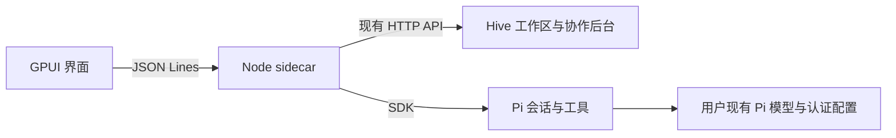

# 桌面进程接口

Rust 窗口启动 Node sidecar，以私有 stdin/stdout JSON Lines 通道通信。普通日志进入 stderr。Node 启动真实 Hive 后台并在内存中保存 UI cookie；窗口不持有该 cookie 或 Pi 凭据。

Hive 2.2.1 通过可重现 pnpm 补丁开放执行器 factory 与派生成员后端选择。`hive:pi` 选择内置 Pi，普通 CLI 保留原 PTY 路径。当前选择的主会话绑定工作区主控；派生成员绑定自己的 Pi 会话。SDK 注册的 team 工具逐次读取当前身份令牌并调用原生 team CLI，不能在共享进程环境变量中设置成员令牌。

请求格式为 `{id, method, params}`；响应为 `{id, result}` 或 `{id, error:{code,message,details?}}`。`hive.request` 保持 Hive 原有 HTTP 字段与鉴权规则。

| 方法 | 参数 | 结果 |
| --- | --- | --- |
| initialize | 空对象 | version、dataDir、hivePort |
| hive.request | method、path、body? | Hive 原始响应；只接受本地 `/api/` 路径 |
| chat.list | workspaceId | 当前工作区的桌面会话列表 |
| chat.create | workspaceId | 新会话及完整快照 |
| chat.open | sessionId | 会话及完整快照 |
| chat.prompt | sessionId、text | accepted 与更新后的 session 元数据 |
| chat.abort | sessionId | 取消并等待该次调用结束 |
| chat.resume | sessionId | 启动/恢复该成员并继续待处理投递 |
| chat.setModel | sessionId、provider、modelId | 修改本会话模型，保留全局默认 |
| shutdown | 空对象 | 取消活动调用、释放 Pi 和 Hive 后退出 |

Agent 通知为 `{event:"agent",data:{type,sessionId,sequence,...}}`。事件包括文本增量、用户/助手消息结束、工具开始/更新/结束、错误、`state {busy,pending}` 和 settled。state 表示真实队列状态，包括暂停时新增投递和取消后移除消息；settled 在队列从运行转为空闲时发出。重试中的错误不等于调用结束；模型回合结束不等于 Hive 任务完成。

快照包含 `history`、对齐的 `historyMessageIds`、可选 `activeMessage`、`eventSequence`、`busy`、`pending`、`runId`、模型列表与会话信息。恢复视图先应用快照，再应用水位之后的排队事件，避免重复或丢失已生成文本。序号属于当前运行中的桌面会话流，不承诺跨进程连续。

桌面 index.json 保存导航、成员绑定、Pi 会话引用和空会话启动上下文。Hive 保存工作区及团队账本，Pi 保存对话。独立的投递文件仅保存已接受但尚未完成的输入；先落盘再确认，串行交给 SDK，成功后在 Pi transcript 中记完成 ID 再移除投递。失败保留消息并暂停，用户明确继续；关闭后台保留未完成投递。模型完成与完成标记写入之间仍有崩溃窗口，不承诺工具副作用 exactly-once。空 Pi 会话尚未落盘时，桌面会话 ID 与启动上下文仍可恢复。
