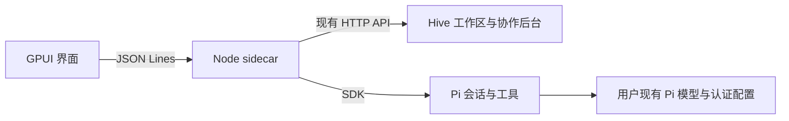

# 桌面进程接口

Rust 窗口启动 Node sidecar，以私有 stdin/stdout JSON Lines 通道通信。普通日志进入 stderr。Node 启动真实 Hive 后台并在内存中保存 UI cookie；窗口不持有该 cookie 或 Pi 凭据。

Hive 2.2.1 通过可重现 pnpm 补丁开放执行器 factory 与派生成员后端选择。`hive:pi` 选择内置 Pi，普通 CLI 保留原 PTY 路径。当前选择的主会话绑定工作区主控；派生成员绑定自己的 Pi 会话。SDK 注册的 team 工具逐次读取当前身份令牌并调用原生 team CLI，不能在共享进程环境变量中设置成员令牌。

请求格式为 `{id, method, params}`；响应为 `{id, result}` 或 `{id, error:{code,message,details?}}`。`hive.request` 保持 Hive 原有 HTTP 字段与鉴权规则。

| 方法 | 参数 | 结果 |
| --- | --- | --- |
| initialize | 空对象 | version、dataDir、hivePort |
| hive.request | method、path、body? | Hive 原始响应；只接受本地 `/api/` 路径 |
| chat.list | workspaceId | 当前工作区全部桌面会话列表（含归档，供身份/成员绑定复用） |
| chat.search | query、archived?（默认 false）、offset?（默认 0） | 当前筛选的 matches（最多 100）及 total |
| chat.archive | sessionId、archived（布尔值） | 保存后的 session 与本工作区完整 sessions |
| chat.create | workspaceId | 新会话及完整快照 |
| chat.open | sessionId | 会话及完整快照 |
| chat.prompt | sessionId、text、attachmentIds? | accepted 与更新后的 session 元数据 |
| chat.attachments.add | workspaceId、path（本地绝对路径） | 工作区上传的 attachment 引用及原始 image 内容 |
| chat.attachments.clipboard | workspaceId、image（规范 PromptImage） | 进入相同 Hive 上传的附件引用及原字节，不接收客户端路径 |
| chat.attachments.get | workspaceId、ids | 经工作区校验的 attachment/image 列表 |
| chat.abort | sessionId | 取消并等待该次调用结束 |
| chat.resume | sessionId | 启动/恢复该成员并继续待处理投递 |
| chat.setModel | sessionId、provider、modelId | 修改本会话模型，保留全局默认 |
| shutdown | 空对象 | 取消活动调用、释放 Pi 和 Hive 后退出 |

Agent 通知为 `{event:"agent",data:{type,sessionId,sequence,...}}`。事件包括文本增量、用户/助手消息结束、工具开始/更新/结束、错误、`state {busy,pending}` 和 settled。state 表示真实队列状态，包括暂停时新增投递和取消后移除消息；settled 在队列从运行转为空闲时发出。重试中的错误不等于调用结束；模型回合结束不等于 Hive 任务完成。

`chat.open` 快照与 `state` 可带 `deliveryFailure: {deliveryId,message}`。仅当既有聊天索引的最后失败记录匹配当前投递队列头时返回；成功或取消移除队列头后不再返回。它是投递诊断，不是任务状态，也不改变原生会话历史。`chat.resume` 沿用原有队列及 deliveryId，Pi 的原生历史可以保留多次执行尝试，桌面按相同投递 ID 展示一条用户输入。若保存诊断失败，`error` 带 `diagnosticWriteFailed:true`，原队列仍保留；该临时告警不能被当作诊断已持久保存。原始错误只在详情中展示和复制。

快照包含 `history`、对齐的 `historyMessageIds`、可选 `activeMessage`、`eventSequence`、`busy`、`pending`、`runId`、模型列表与会话信息。恢复视图先应用快照，再应用水位之后的排队事件，避免重复或丢失已生成文本。序号属于当前运行中的桌面会话流，不承诺跨进程连续。

桌面 index.json 保存导航、成员绑定、Pi 会话引用和空会话启动上下文。Hive 保存工作区及团队账本，Pi 保存对话。独立的投递文件仅保存已接受但尚未完成的输入；先落盘再确认，串行交给 SDK，成功后在 Pi transcript 中记完成 ID 再移除投递。失败保留消息并暂停，用户明确继续；关闭后台保留未完成投递。模型完成与完成标记写入之间仍有崩溃窗口，不承诺工具副作用 exactly-once。空 Pi 会话尚未落盘时，桌面会话 ID 与启动上下文仍可恢复。

## 图片用户输入

`chat.prompt` 的 `text` 仍必须为字符串；有图片时可为空。attachmentIds 最多 10 个不同的 UUID，图片限制为规范 base64 每张 5,000,000 字符、合计 20,000,000 字符。上传使用现有 Hive 工作区上传接口及文件/SQLite 数据，不新增上传数据库。

原生客户端将图片引用编码为用户文本末尾的版本元数据：`\n\n<!-- hive-desktop-images:v1 ["上传 UUID"] -->`。该字符串与正文由现有 Hive user-input 消息表共同持久保存；无需修改 Hive HTTP/schema。仅在显式 `origin:user` 的结构化投递中解码，工作区校验后加载原图进入同一投递队列；保留 Hive 的上下文尾部。原始编码文本保存在 presentation.sourceText，界面显示干净正文，presentation.attachments 保存上传身份。模型收到原始图片字节而不是路径或缩略图。

这是原生客户端的保留格式，并非 Hive 通用附件协议。桌面文字包含该标记时会包一层空元数据，只解一次，保留用户原文；直接使用 Web/HTTP 手写此保留格式会被原生接入器解释。现有 Web 页面没有对应附件投影，不能把它视为已支持桌面图片消息的跨端展示。

发送前校验上传归属及已知模型图片能力。上传副本独立于用户原文件；待发送草稿保留引用直到后台确认接受。后台确认前崩溃或响应丢失仍可能留下不确定草稿，需要用户核对历史后处理，不承诺跨 Hive 与桌面两个存储的恰好一次发送。详见 [图片附件验证](validation/2026-11-08-image-attachments.md)。

## 会话归档

归档是桌面导航元数据，不停止 Agent 或更改 Hive 协作状态。成功保存或幂等请求发出 `session_navigation {sessionId,sequence,archived,pinned,updatedAt}`，界面按事件顺序应用状态，RPC 回执只确认请求。忙碌、待投递或有未结派单的会话不能归档；新实际输入会在入队前恢复。全量列表保留归档记录，默认搜索和置顶过滤归档；归档搜索显式传 archived=true。实现和验证边界见 [归档记录](validation/2026-11-08-session-archives.md)。

## 思考内容展示

Agent assistant_delta 的 kind 为 thinking 时，Rust 使用 messageId/contentIndex 维护独立思考段；message_end 与快照中的原生 content 提供最终内容。此处复用既有通知，并未添加 reasoning 请求或修改模型行为。未公开的 redacted_thinking 数据不显示，思考结束或取消不替代 Hive 汇报结算。见 [展示验证](validation/2026-11-08-thinking-display.md)。

## 会话推理设置

`chat.reasoning {sessionId}` 和 `chat.setReasoning {sessionId,level}` 返回原生 `{level,levels,description?,model?}`，支持内置 Pi、外部 Pi、Codex 和 Claude。档位来自当前原生模型，setter 拒绝未知档位及生成中的修改，返回原生实际生效值。`native` 表示原生未明确给出档位，不是可选择的重置指令。

Pi 仅保存原生会话记录；Codex/Claude 的显式选择保存在现有 ChatIndex 可选字段 `reasoning:{provider,modelId,level}`，仅向匹配模型重放。实际切换模型清除该选择，重选同模型不重置原生设置。恢复失败保留会话读取，发送前要求重新选择有效档位。原生 setter 失败会释放原句柄并有界重开，避免继续使用部分修改状态。

配置写入失败复用暂停/释放生命周期，由配置 RPC 返回友好错误，不重复注入聊天 Agent 错误；原始错误保留后台诊断。上述不是原生记录与桌面索引的跨文件事务。见 [Pi 验证](validation/2026-11-08-pi-reasoning.md) 和 [外部验证](validation/2026-11-08-external-reasoning.md)。

## 外部程序版本检查

`desktop.settings.probe {backend,command}` 检查当前输入，command 为 null 时对应留空/PATH；环境覆盖优先。返回 `{backend,command,source,status,version?,message,verifiedVersion}`，不写设置；source 为 env/app/path/draft，status 为 available/not_found/failed/timeout/cancelled。`available` 仅是成功读取版本，不验证协议或认证。5 秒/64 KiB 有界检查复用 CLI 所有权，shutdown 取消并等待活动检查。见 [验证](validation/2026-11-08-executable-check.md)。

## 普通文件附件

`chat.attachments.add/get` 现在返回混合 StagedAttachment：`{attachment,image? ,filePath?}`。普通文件的 filePath 来自工作区上传记录的内部 metadata/stat getter，图片仍返回原生 image 块。`chat.attachments.path {workspaceId,id}` 验证上传存在/归属后返回 `{path}` 用于本机定位。HTTP 上传响应不增加本机路径。`chat.prompt` 的 attachmentIds 及已有版本编码不变，用户展示保留正文和附件 metadata，普通文件路径清单加入实际 Agent 输入；不自动内联文件内容或执行文件。见 [验证](validation/2026-11-08-file-attachments.md)。

## `chat.usage`

参数 `{sessionId}`，只读原生会话统计。返回 `{source,reports:[{label,counters:[{key,label,tokens}]}],context?,notice?}`；context 为 `{tokens:number|null,window:number,percent:number|null,estimated:boolean}`。计数必须为非负安全整数；没有报告时 reports 为空并说明边界，不补零、不发模型请求、不合并厂商计费口径。Pi 使用原生 SDK/RPC，Codex 接收当前线程 tokenUsage 通知，Claude 使用关联回合的最新 result。详情见 [验证](validation/2026-11-08-agent-usage.md)。

## Pi 模型配置

`pi.models.get {}` 返回 `{path,revision,apis,providers}`；提供商只暴露公共编辑字段，模型包含 `overrideOnly`。仅存在 modelOverrides 的条目以 `reasoning/vision: boolean|null` 区分显式能力与继承；不表示模型一定可用于当前会话。`pi.models.change {revision,change}` 复用 provider/model/removeProvider/removeModel 操作，返回 `{conflict,snapshot}`。model 的 reasoning/vision 可以为 null，表示移除相应显式配置，保留 Pi 原生继承语义；普通自定义模型的既有布尔请求仍有效。编辑覆盖项不新增 models，删除最后一项会清理无其他有效设置的空提供商覆盖。高级字段/凭据不跨此接口返回，保存保持原文件中的未编辑内容，详见 [验证](validation/2026-11-08-pi-model-overrides.md)。

## 待处理用户输入

`chat.open` 和 state 增加 `pendingUserInputs:[{deliveryId,text,attachments,processing}]`，只从既有 spool 中 origin=user 的展示元数据生成；不新增持久队列。attachments 是原上传公共 metadata，text 是已归一化的用户原文，不返回隐藏上下文。UI 过滤当前处理/已在历史出现的条目，标明等待；沿既有 chat.prompt 排队，chat.abort 仅取消当前回合，暂停队列仍由 chat.resume 显式继续。旧响应缺失字段时，Rust 按空列表读取。详见 [验证](validation/2026-11-08-queued-user-inputs.md)。
