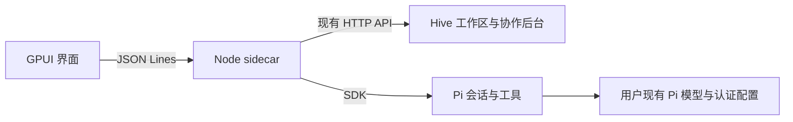

# 桌面进程接口

Rust 窗口启动 Node sidecar，以私有 stdin/stdout JSON Lines 通道通信。普通日志进入 stderr。Node 启动真实 Hive 后台并在内存中保存 UI cookie；窗口不持有该 cookie 或 Pi 凭据。

Hive 2.2.1 通过可重现 pnpm 补丁开放执行器 factory 与派生成员后端选择。`hive:pi` 选择内置 Pi，普通 CLI 保留原 PTY 路径。当前选择的主会话绑定工作区主控；派生成员绑定自己的 Pi 会话。SDK 注册的 team 工具逐次读取当前身份令牌并调用原生 team CLI，不能在共享进程环境变量中设置成员令牌。

请求格式为 `{id, method, params}`；响应为 `{id, result}` 或 `{id, error:{code,message,details?}}`。`hive.request` 保持 Hive 原有 HTTP 字段与鉴权规则。

| 方法 | 参数 | 结果 |
| --- | --- | --- |
| initialize | 空对象 | version、dataDir、hivePort |
| hive.request | method、path、body? | Hive 原始响应；只接受本地 `/api/` 路径 |
| chat.list | workspaceId | 当前工作区全部桌面会话列表（含归档，供身份/成员绑定复用） |
| chat.search | query、archived?（默认 false）、offset?（默认 0） | 当前筛选的 matches（最多 100）及 total |
| chat.archive | sessionId、archived（布尔值） | 保存后的 session 与本工作区完整 sessions |
| chat.create | workspaceId | 新会话及完整快照 |
| chat.open | sessionId | 会话及完整快照 |
| chat.prompt | sessionId、text、attachmentIds? | accepted 与更新后的 session 元数据 |
| chat.attachments.add | workspaceId、path（本地绝对路径） | 工作区上传的 attachment 引用及原始 image 内容 |
| chat.attachments.clipboard | workspaceId、image（规范 PromptImage） | 进入相同 Hive 上传的附件引用及原字节，不接收客户端路径 |
| chat.attachments.get | workspaceId、ids | 经工作区校验的 attachment/image 列表 |
| chat.abort | sessionId | 取消并等待该次调用结束 |
| chat.resume | sessionId | 启动/恢复该成员并继续待处理投递 |
| chat.setModel | sessionId、provider、modelId | 修改本会话模型，保留全局默认 |
| shutdown | 空对象 | 取消活动调用、释放 Pi 和 Hive 后退出 |

Agent 通知为 `{event:"agent",data:{type,sessionId,sequence,...}}`。事件包括文本增量、用户/助手消息结束、工具开始/更新/结束、错误、`state {busy,pending}` 和 settled。state 表示真实队列状态，包括暂停时新增投递和取消后移除消息；settled 在队列从运行转为空闲时发出。重试中的错误不等于调用结束；模型回合结束不等于 Hive 任务完成。

快照包含 `history`、对齐的 `historyMessageIds`、可选 `activeMessage`、`eventSequence`、`busy`、`pending`、`runId`、模型列表与会话信息。恢复视图先应用快照，再应用水位之后的排队事件，避免重复或丢失已生成文本。序号属于当前运行中的桌面会话流，不承诺跨进程连续。

桌面 index.json 保存导航、成员绑定、Pi 会话引用和空会话启动上下文。Hive 保存工作区及团队账本，Pi 保存对话。独立的投递文件仅保存已接受但尚未完成的输入；先落盘再确认，串行交给 SDK，成功后在 Pi transcript 中记完成 ID 再移除投递。失败保留消息并暂停，用户明确继续；关闭后台保留未完成投递。模型完成与完成标记写入之间仍有崩溃窗口，不承诺工具副作用 exactly-once。空 Pi 会话尚未落盘时，桌面会话 ID 与启动上下文仍可恢复。

## 图片用户输入

`chat.prompt` 的 `text` 仍必须为字符串；有图片时可为空。attachmentIds 最多 10 个不同的 UUID，图片限制为规范 base64 每张 5,000,000 字符、合计 20,000,000 字符。上传使用现有 Hive 工作区上传接口及文件/SQLite 数据，不新增上传数据库。

原生客户端将图片引用编码为用户文本末尾的版本元数据：`\n\n<!-- hive-desktop-images:v1 ["上传 UUID"] -->`。该字符串与正文由现有 Hive user-input 消息表共同持久保存；无需修改 Hive HTTP/schema。仅在显式 `origin:user` 的结构化投递中解码，工作区校验后加载原图进入同一投递队列；保留 Hive 的上下文尾部。原始编码文本保存在 presentation.sourceText，界面显示干净正文，presentation.attachments 保存上传身份。模型收到原始图片字节而不是路径或缩略图。

这是原生客户端的保留格式，并非 Hive 通用附件协议。桌面文字包含该标记时会包一层空元数据，只解一次，保留用户原文；直接使用 Web/HTTP 手写此保留格式会被原生接入器解释。现有 Web 页面没有对应附件投影，不能把它视为已支持桌面图片消息的跨端展示。

发送前校验上传归属及已知模型图片能力。上传副本独立于用户原文件；待发送草稿保留引用直到后台确认接受。后台确认前崩溃或响应丢失仍可能留下不确定草稿，需要用户核对历史后处理，不承诺跨 Hive 与桌面两个存储的恰好一次发送。详见 [图片附件验证](validation/2026-11-08-image-attachments.md)。

## 会话归档

归档是桌面导航元数据，不停止 Agent 或更改 Hive 协作状态。成功保存或幂等请求发出 `session_navigation {sessionId,sequence,archived,pinned,updatedAt}`，界面按事件顺序应用状态，RPC 回执只确认请求。忙碌、待投递或有未结派单的会话不能归档；新实际输入会在入队前恢复。全量列表保留归档记录，默认搜索和置顶过滤归档；归档搜索显式传 archived=true。实现和验证边界见 [归档记录](validation/2026-11-08-session-archives.md)。

## 思考内容展示

Agent assistant_delta 的 kind 为 thinking 时，Rust 使用 messageId/contentIndex 维护独立思考段；message_end 与快照中的原生 content 提供最终内容。此处复用既有通知，并未添加 reasoning 请求或修改模型行为。未公开的 redacted_thinking 数据不显示，思考结束或取消不替代 Hive 汇报结算。见 [展示验证](validation/2026-11-08-thinking-display.md)。

## Pi 会话推理设置

`chat.reasoning {sessionId}` 和 `chat.setReasoning {sessionId,level}` 返回原生 `{level,levels}`，目前仅内置/外部 Pi 支持。档位从原生能力读取，setter 拒绝未知档位及生成中的修改，只保存到原生会话。配置写入失败复用已有暂停/释放生命周期，后续请求重新加载持久记录；不新增桌面偏好副本，也不声称跨文件事务。见 [验证](validation/2026-11-08-pi-reasoning.md)。
