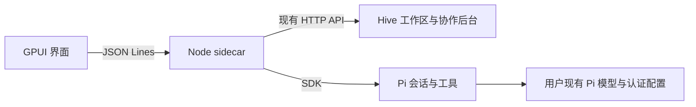

# 桌面进程接口

Rust 窗口启动 Node sidecar，以私有 stdin/stdout JSON Lines 通道通信。普通日志进入 stderr。Node 启动真实 Hive 后台并在内存中保存 UI cookie；窗口不持有该 cookie 或 Pi 凭据。

当前 Pi 会话尚未绑定到 Hive 的团队执行接口；这一连接仍是后续必需工作，不能由图中的并列连接推断已经完成协作。

请求格式为 `{id, method, params}`；响应为 `{id, result}` 或 `{id, error:{code,message,details?}}`。`hive.request` 保持 Hive 原有 HTTP 字段与鉴权规则。

| 方法 | 参数 | 结果 |
| --- | --- | --- |
| initialize | 空对象 | version、dataDir、hivePort |
| hive.request | method、path、body? | Hive 原始响应；只接受本地 `/api/` 路径 |
| chat.list | workspaceId | 当前工作区的桌面会话列表 |
| chat.create | workspaceId | 新会话及完整快照 |
| chat.open | sessionId | 会话及完整快照 |
| chat.prompt | sessionId、text | accepted 与更新后的 session 元数据 |
| chat.abort | sessionId | 取消并等待该次调用结束 |
| chat.setModel | sessionId、provider、modelId | 修改本会话模型，保留全局默认 |
| shutdown | 空对象 | 取消活动调用、释放 Pi 和 Hive 后退出 |

Agent 通知为 `{event:"agent",data:{type,sessionId,sequence,...}}`。事件包括文本增量、消息结束、工具开始/更新/结束、错误和 settled。重试中的错误不等于调用结束；每个接受的 prompt 结束后有一个 settled。模型回合结束不等于 Hive 任务完成。

快照包含 `history`、对齐的 `historyMessageIds`、可选 `activeMessage`、`eventSequence`、`busy`、模型列表与会话信息。恢复视图先应用快照，再应用水位之后的排队事件，避免重复或丢失已生成文本。序号属于当前运行中的桌面会话流，不承诺跨进程连续。

桌面 index.json 只保存导航元数据和 Pi 会话文件引用。Hive 保存工作区及团队账本，Pi 保存对话；不在桌面另建派单账本。空 Pi 会话尚未落盘时，桌面会话 ID 仍可在重启后保持，恢复时再创建 SDK 空会话。
